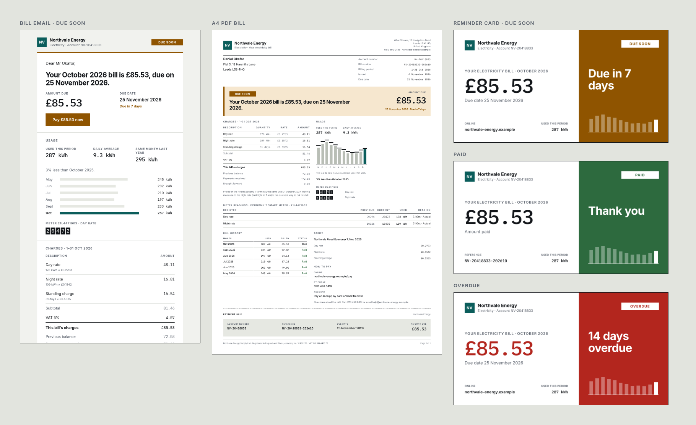
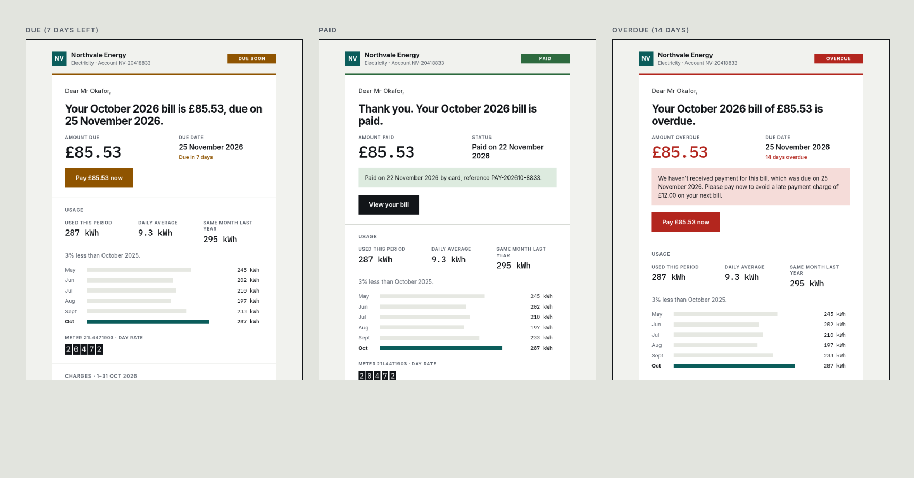
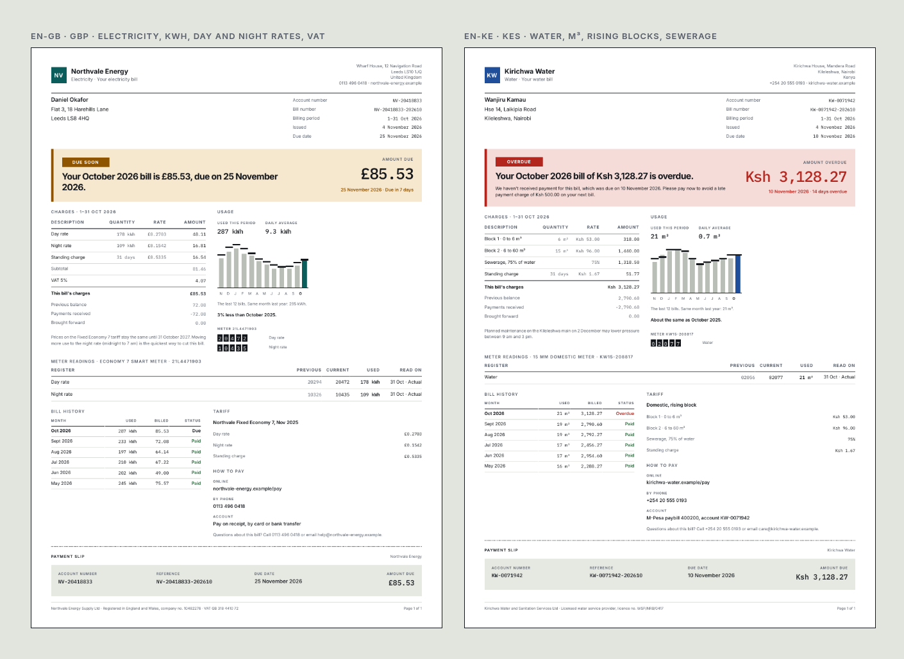
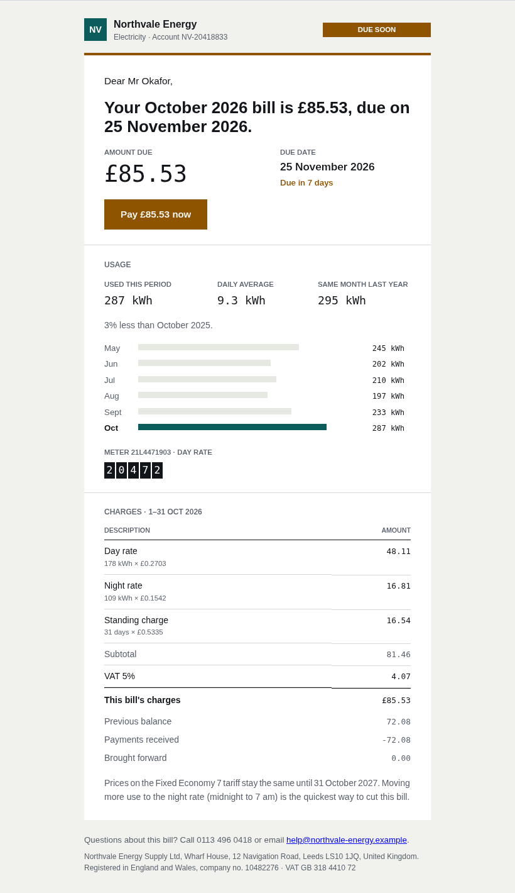
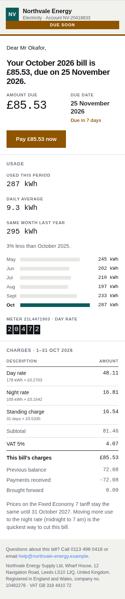
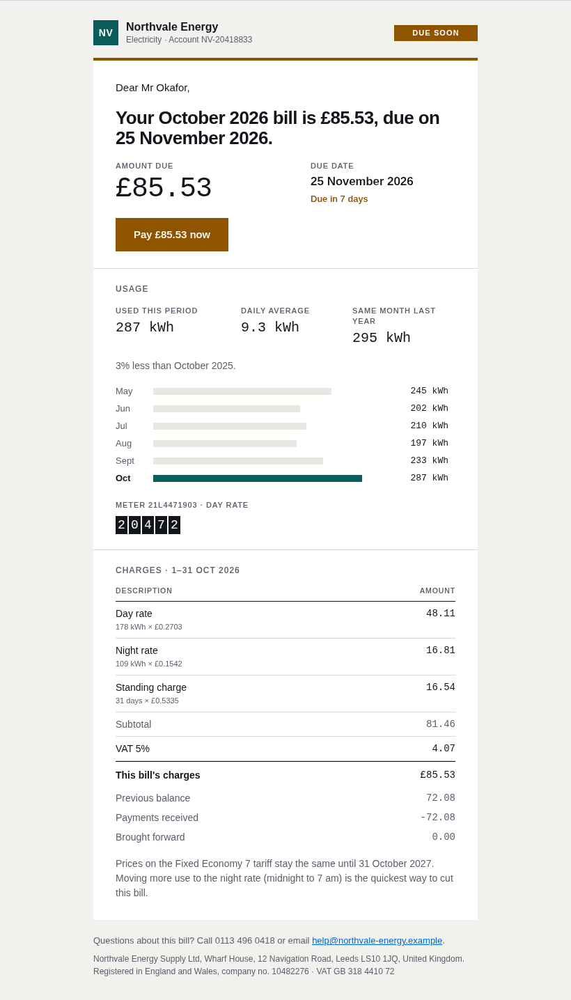
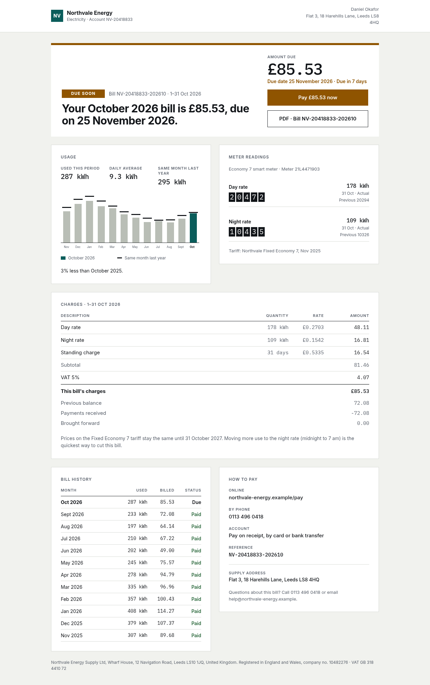
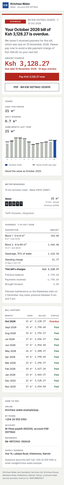
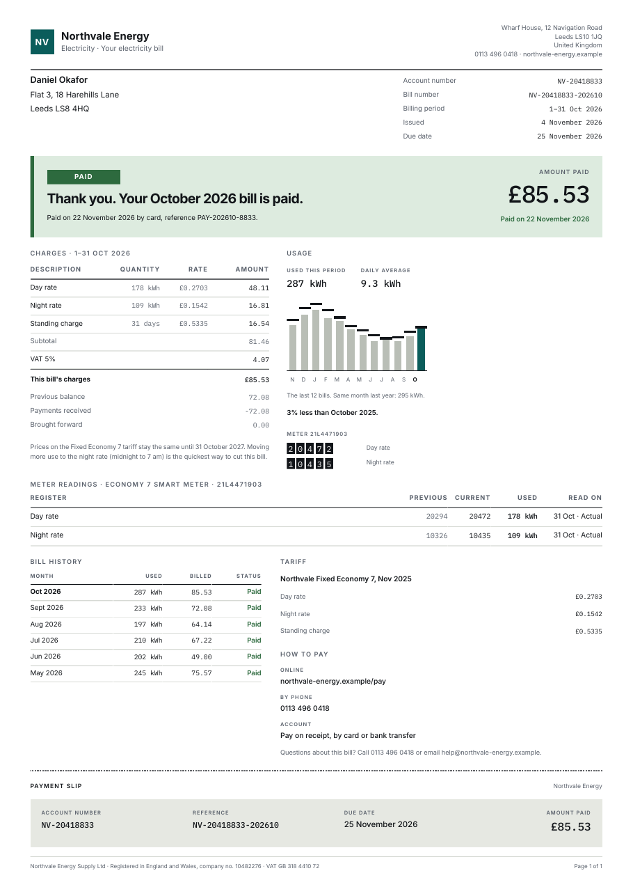

# Metered

**One meter account file in. The bill email, the online bill, the A4 PDF bill and a reminder card out, each in the bill's real state: due, paid or overdue.**

A utility billing kit for [Hyper Elements](https://hyperelements.dev), built for the Hyper Elements Template Challenge (November 2026). It is for anyone who bills for metered use: an energy or water supplier, a housing association or student landlord recharging utilities, a co-working space billing tenants for power, a billing platform that wants customer-facing documents it doesn't have to build. Bring the meter readings, the tariff and the payments; Metered works out the charges and the state, and makes the messages a customer actually gets, in their currency, language and unit.



**For judges, no install needed:** every output is committed in [`examples/`](examples). Open [`examples/northvale-energy/due/`](examples/northvale-energy/due), [`paid/`](examples/northvale-energy/paid) and [`overdue/`](examples/northvale-energy/overdue) for one bill in each state, [`examples/northvale-energy/year/`](examples/northvale-energy/year) for twelve months of bills from the same file, and [`examples/checks.json`](examples/checks.json) for the gate's result.

## What it makes

From one account file (`data/*.json`), each output with a job only its format can do:

| Output | Root | Job | Sample |
| --- | --- | --- | --- |
| Bill email + plain text | `Email` | One template for three messages: "your bill is ready", "payment received", "your bill is overdue". The amount, the date and what to do are first, in the state's colour; then the meter reading, use against the last six bills, the charges and the balance carried. | [`due`](examples/northvale-energy/due/email.html) · [`paid`](examples/northvale-energy/paid/email.html) · [`overdue`](examples/northvale-energy/overdue/email.html) · [`.txt`](examples/northvale-energy/due/email.txt) |
| Online bill | `Page` | What the email's button opens: the state, amount and pay button first, then a year of use as a chart with the same month last year marked, every register's reading with how it was taken, the charges, the last twelve bills, how to pay. Phone copies of the wide parts. | [`page.html`](examples/northvale-energy/due/page.html) |
| PDF bill, A4 | `Document` → `renderPdf()` | The copy that is posted, printed and kept, and asked for as proof of address. One page: account and bill facts, the state band, charges beside the usage chart, meter readings, recent bills, the tariff's rates, how to pay and a payment slip to tear off. | [`bill.pdf`](examples/northvale-energy/due/bill.pdf) |
| Reminder card, 1200×630 | `Canvas` → `renderImage()` | For where an email isn't read: WhatsApp or SMS, a push notification, an in-app banner. "Due in 7 days", "Thank you", "14 days overdue" in a full-height panel of the state's colour, with the amount and where to pay. | [`due`](examples/northvale-energy/due/reminder.png) · [`paid`](examples/northvale-energy/paid/reminder.png) · [`overdue`](examples/northvale-energy/overdue/reminder.png) |
| The year of bills | `Document` × N | Every bill in the file as it stood, from the same template, with balances and late payment charges carried through. | [`year/`](examples/northvale-energy/year) (12 bills) |



### States are worked out, never typed

Nobody sets "overdue" by hand. A bill's state comes from the file: the payments made since it was issued, and the file's `asOf` date against the due date. The examples show one bill in all three states by looking at the same file on three days (`scenario()` in [`src/bill.ts`](src/bill.ts)): as written (due in 7 days), after the customer pays (paid), and two weeks after the due date with nothing paid (overdue). The Kirichwa Water sample's real state on its `asOf` date is overdue.

Balances are a running ledger, as real accounts are: a bill paid after the next one was issued is carried forward as a previous balance, and a bill still unpaid 14 days after its due date gets a late payment charge on the next bill (once, and without VAT, since it is compensation rather than a supply). The Northvale sample's February bill shows this: paid 19 days late, carried into March, and charged on April.

### Any service, unit, tariff and currency

| File | Utility | Locale, currency | Shows |
| --- | --- | --- | --- |
| [`northvale-energy.json`](data/northvale-energy.json) | Northvale Energy, Leeds | en-GB, GBP | Electricity in kWh on an Economy 7 meter: day and night registers at their own rates, a standing charge, VAT at 5%, an estimated reading, a goodwill credit, a late payment |
| [`kirichwa-water.json`](data/kirichwa-water.json) | Kirichwa Water, Nairobi | en-KE, KES | Water in m³ on rising blocks (0 to 6, 6 to 60, over 60), sewerage at 75% of the water charge, meter rent per day, no VAT, a customer's own reading, M-Pesa payments |



The unit, the service name, the decimals a reading has and every printed word come from the file (`labels` replaces any of them). Money is worked out in whole minor units, each line rounded once, half up, so totals never drift; `Intl.NumberFormat` respects each currency's own minor unit.

## How Hyper Elements is used

| What | Where |
| --- | --- |
| **All four roots**, each with its own job: `Email` (the message), `Page` (the online bill), `Document` (the A4 bill and the year batch), `Canvas` (the reminder card) | [`templates/`](templates) |
| **One theme**, `defineTheme()` with colour, font, size and line-height tokens, element defaults (heading scale, square Button, Divider), named styles and `formats.document` / `formats.canvas` overrides. The utility's accent goes in through **`extendTheme()`**; the three state colours are shared by every root | [`src/theme.ts`](src/theme.ts) |
| **`defineElement()`** for typed, validated blocks: `metered.Register` (a meter reading as a row of dark digit cells, the way the meter on the wall shows it), `metered.Badge` (the state tag) and `metered.Mark` (the utility's letters, a logo that shows with images off) | [`src/parts.tsx`](src/parts.tsx) |
| **Shared components across roots**: the same `ChargesTable`, `ReadingsTable`, `Register` and `Letterhead` build the email, the page and the PDF, so a figure cannot differ between them | [`src/parts.tsx`](src/parts.tsx) |
| **`Svg` with `Rect` and `Line`** for the usage chart (twelve bills, the current one in the accent, a tick for the same month last year) on the Page, Document and Canvas. The **Email gets no Svg**: its usage chart is `UsageRows`, bars made of sized boxes, which every client draws | [`src/parts.tsx`](src/parts.tsx) |
| **`Table` / `TableRow header` / `TableRow footer` / `TableCell`** for charges, readings and bill history, totals as footer rows | [`src/parts.tsx`](src/parts.tsx), [`templates/bill-pdf.tsx`](templates/bill-pdf.tsx) |
| **`Grid` with `columns` and `stackOnMobile`**, **phone styles and `hidden`** in the Email and Page only: the page's cards stack, and the chart and charges table swap to phone copies (a table cell's width can't change on a phone) | [`templates/bill-page.tsx`](templates/bill-page.tsx), [`templates/bill-email.tsx`](templates/bill-email.tsx) |
| **Document parts**: `PageHeader`, `PageFooter`, `PageNumber` and `PageNumber total` | [`templates/bill-pdf.tsx`](templates/bill-pdf.tsx) |
| **`render()`** for the email's HTML and plain-text twin and the page; **`renderPdf()`** and **`renderImage()`** natively, fonts passed as bytes, no headless browser at render time | [`scripts/make.tsx`](scripts/make.tsx), [`src/fonts.ts`](src/fonts.ts) |
| **The gate**: the data checks, then **`validate()`** on every artefact in all three states and every bill of the year, with **`emailClients()`** and **`lint({ kind: "transactional" })`** on each email and `lint()` on each page. Errors **and warnings** fail it (it caught the email's columns being too wide for classic Outlook, and a state colour below 4.5:1 contrast); `make` renders nothing unless it passes | [`scripts/lib.tsx`](scripts/lib.tsx), [`src/check.ts`](src/check.ts) |
| **`renderInEmailClients()`** previews of classic Outlook, Gmail (web and app) and Apple Mail (light, dark, iPhone), screenshotted | [`scripts/shots.tsx`](scripts/shots.tsx), [`examples/northvale-energy/clients/`](examples/northvale-energy/clients) |
| **Gallery-ready**: every template has `export const meta = { title, description, root }` and a default export that renders the sample with no props, the shape of the official gallery's templates, so `npx hyper-elements check templates/bill-email.tsx` works on any of them | [`templates/`](templates) |

The current gate result is in [`examples/checks.json`](examples/checks.json): **0 errors, 0 warnings** across 48 artefacts. The notes it counts are things a client draws slightly differently (Outlook squares corners and draws 500-weight text as normal) and lint's note on labels under 14px, each an accepted trade-off.

### In email clients

| Classic Outlook | Gmail app, iPhone (no media queries) | Apple Mail, dark |
| --- | --- | --- |
|  |  |  |

What each client removed or changed is in [`clients/findings.json`](examples/northvale-energy/clients/findings.json). These are the library's local client models, not a send to real inboxes.

### More previews

| Online bill, desktop | Online bill, phone (overdue, Kenya) | PDF bill, paid |
| --- | --- | --- |
|  |  |  |

## Run it

Node.js 20 or later.

```bash
npm install
npm run check   # the gate: data checks + validate() + emailClients() + lint(), writes examples/checks.json
npm run make    # gate, then all three states and the year of bills for every file in data/
npm test        # 20 tests: register and block pricing, sewerage, VAT, carried balances, late charges, states, data rules, the gate, page count, card size
npm run shots   # optional: README screenshots and email-client previews (needs Chrome and poppler's pdftoppm)
```

Your own account: copy a file in `data/`, change it, and run `npm run make -- data/your-account.json`. Any template also renders on its own with the official CLI, for example `npx hyper-elements check templates/bill-email.tsx`.

In an app, render from code. Pass no `state` and the bill shows its real one:

```tsx
import { render } from "@hyper-elements/react";
import { renderPdf } from "@hyper-elements/react/pdf";
import { renderImage } from "@hyper-elements/react/image";
import BillEmail from "./templates/bill-email";
import BillPdf from "./templates/bill-pdf";
import ReminderCard from "./templates/reminder-card";
import { loadFonts } from "./src/fonts";

const fonts = await loadFonts();
const { html, text } = await render(<BillEmail file={account} />);
const { pdf } = await renderPdf(<BillPdf file={account} />, { fonts });
const { image } = await renderImage(<ReminderCard file={account} />, { fonts });
```

## The account file

```jsonc
{
  "utility":  { "name", "monogram", "legalName", "address": [], "registration", "phone", "email", "website", "payUrl", "accent" },
  "settings": { "locale": "en-GB", "currency": "GBP", "service": "Electricity", "unit": "kWh", "readingDecimals": 0, "dueSoonDays": 7 },
  "labels":   { /* optional: any printed word */ },
  "account":  { "number", "holder", "salutation", "email", "supplyAddress": [], "meter": { "serial", "type" },
                "payment": { "method": "on-receipt" | "direct-debit", "detail" } },
  "tariff":   { "name", "registers": [{ "code": "DAY", "label": "Day rate", "rate": 0.2703 }],
                "blocks": [{ "upTo": 6, "rate": 53 }, { "upTo": null, "rate": 114 }],   // optional, instead of register rates
                "standingPerDay": 0.5335, "surcharges": [{ "label", "percent" }], "taxes": [{ "label": "VAT", "percent": 5 }],
                "lateFee": { "amount": 12, "afterDays": 14 } },
  "bills":    [{ "id": "2026-10", "start", "end", "issueDate", "dueDate",
                 "readings": [{ "register": "DAY", "previous": 20294, "current": 20472, "date", "kind": "actual" | "estimated" | "customer" }],
                 "adjustments": [{ "label", "amount" }], "payments": [{ "date", "amount", "method", "reference" }], "message" }],
  "history":  { "2024-11": 412 },   // optional: use before the first bill, for the same-month-last-year marks
  "asOf":     "2026-11-18"
}
```

Types: [`src/types.ts`](src/types.ts). The data checks ([`src/check.ts`](src/check.ts)) refuse, with the path to fix: a reading that goes backwards, a reading that doesn't start where the last bill's ended, a reading for a register the tariff doesn't have (or a missing one), overlapping bills, a bill issued before its period ends or due before it was issued, a payment before the bill, blocks that don't rise or don't end open, a register with no rate, an unknown currency or locale.

## Layout of the repo

```
data/                 two sample account files (fictional utilities and customers)
src/types.ts          the account file's shape
src/bill.ts           the account worked out: use, charges, ledger, late charges, states, scenario()
src/money.ts          minor units, rounding, Intl formatting
src/strings.ts        every printed word
src/check.ts          data checks, run before validate()
src/theme.ts          defineTheme() + extendTheme() per utility, the state colours
src/parts.tsx         defineElement() blocks, tables, the Svg chart and the email's box chart
src/context.ts        what every template reads; the default sample
templates/            the four templates (Email, Page, Document, Canvas)
scripts/              check, make, shots
examples/             every rendered output, committed
tests/                vitest
assets/fonts/         Inter and IBM Plex Mono (SIL OFL 1.1, licences included)
```

## Design

A bill is read for three things: how much, by when, and why. So the state is the loudest thing on every output, one flat colour each (ink for due, amber for due soon, green for paid, red for overdue, all at 4.5:1 or better with white); the amount is set large in IBM Plex Mono, the type of a meter's register; the reading itself is drawn as the meter shows it, digit by digit; everything else is calm Inter on cool paper with hairline rules. The utility's accent carries the brand and the current bar of the chart. No gradients, no emoji, no stock images.

## Limits

- Hyper Elements Documents do not flow content across pages, so the bill is designed as one A4 page with the last six bills (the chart shows twelve). A tariff with many more lines (time-of-use with six registers, several adjustments) would need its table split onto a second `Document.Page`.
- There is no Svg in email, so the email's chart is horizontal bars made of boxes; the page, PDF and card draw the full Svg chart.
- Phone styles cannot change a table cell's width, so the page renders a narrower copy of the charges table for phones and hides the desktop one.
- Email clients get the font stacks only; the PDF and PNG embed Inter and IBM Plex Mono.
- Metered presents bills; it is not a rating engine. It prices register rates, rising blocks, standing charges, surcharges and taxes, which covers most household tariffs; anything more (seasonal rates, demand charges, pro-rated tariff changes mid-period) is for your billing system to work out and pass as adjustments.

## Licence

MIT, see [LICENSE](LICENSE). Fonts: Inter and IBM Plex Mono under the SIL Open Font License 1.1 ([`assets/fonts/`](assets/fonts)). All utilities, customers, addresses and figures in `data/` are fictional.

## Author

Chris Gold, X: [@ChrisGold__](https://x.com/ChrisGold__), GitHub: [@AshThunder](https://github.com/AshThunder)
